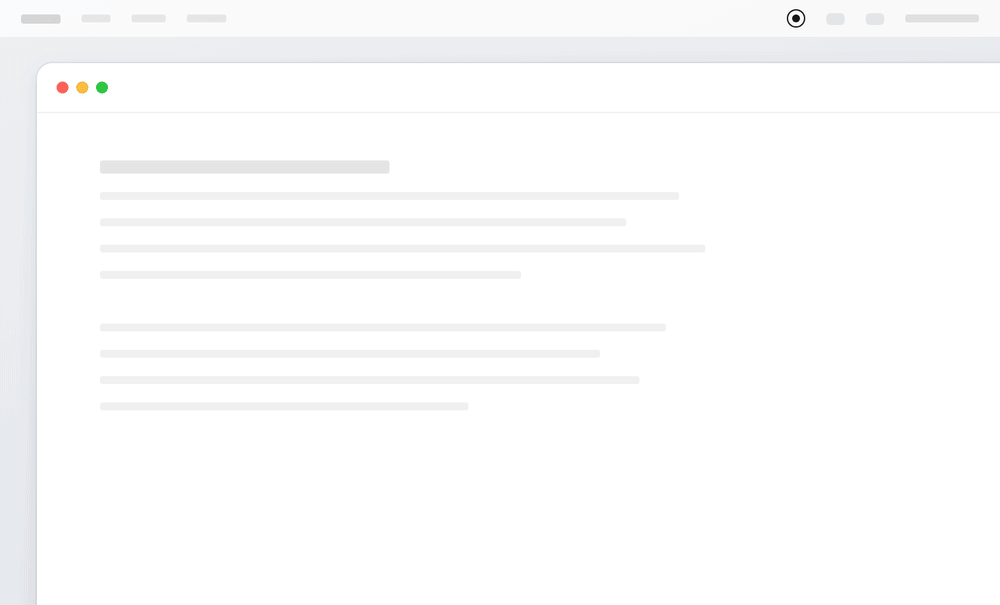
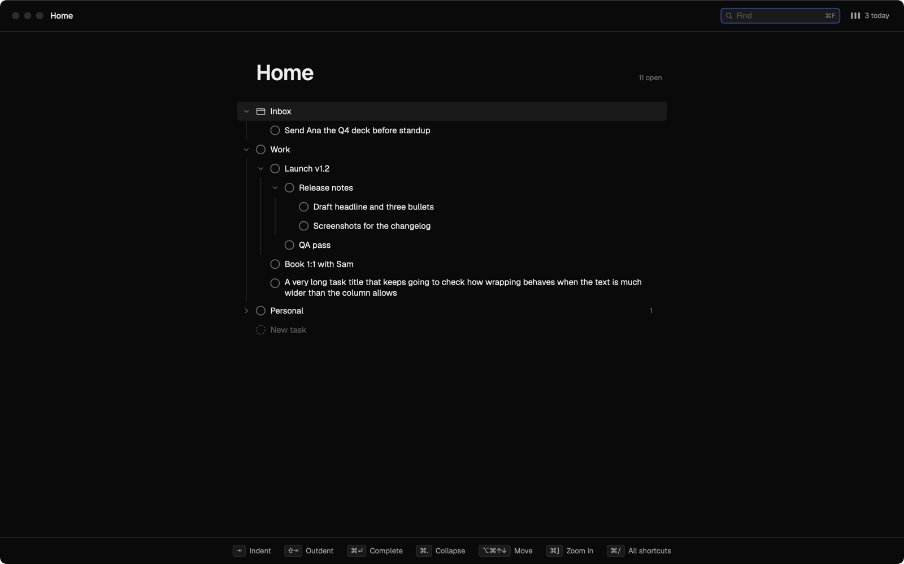
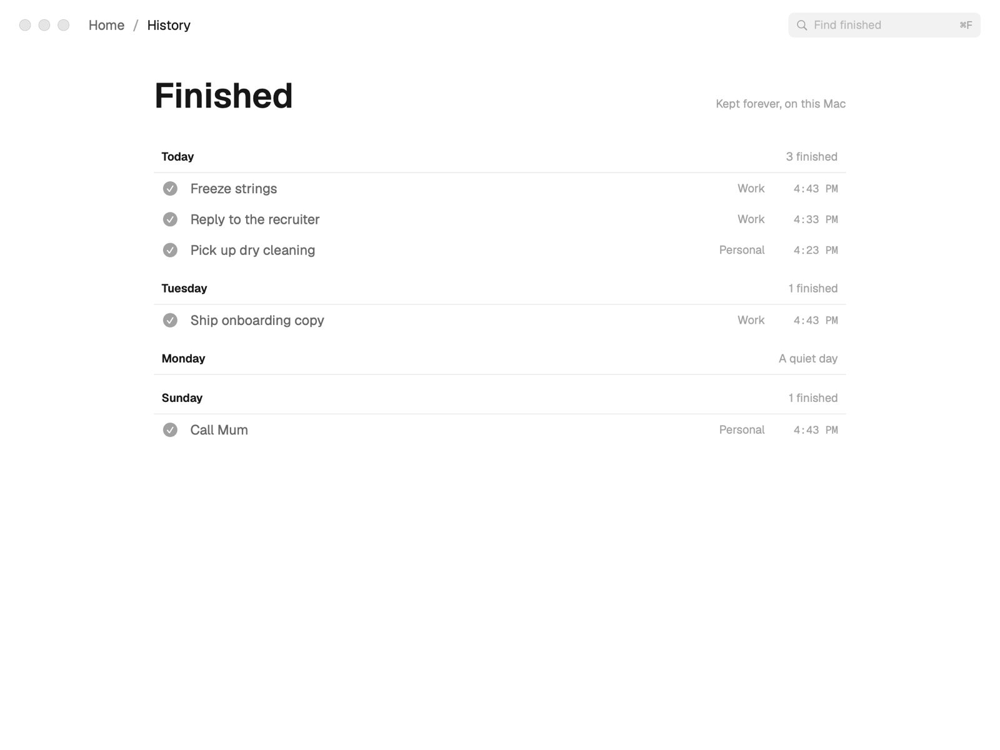
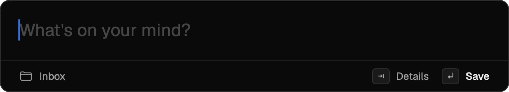
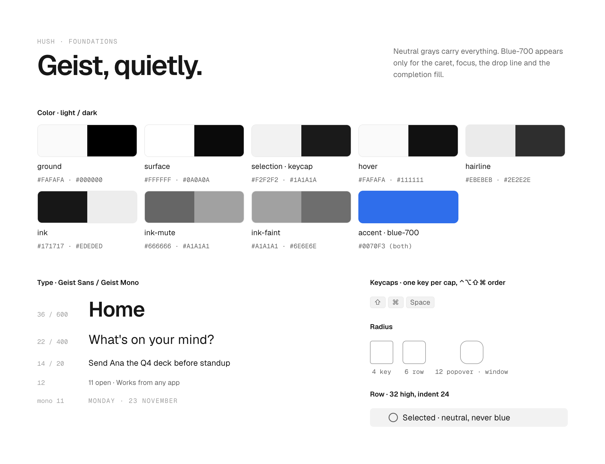

<div align="center">

# Hush

**A todo app that lives in your menu bar and stays out of your way.**

Capture a thought from anywhere in two keystrokes. Organise it in a keyboard-driven outline when you're ready.

[](https://github.com/ashishra0/hush/actions/workflows/ci.yml)


[](LICENSE)



</div>

## Why Hush

- **Two keystrokes to capture.** <kbd>⌘</kbd><kbd>⇧</kbd><kbd>Space</kbd> from any app, type, <kbd>↵</kbd>. Your app keeps focus; nothing else jumps forward.
- **An outline, not a form.** Unlimited nesting, collapse, zoom into any branch, reorder by keyboard or drag. Everything is undoable.
- **Done means gone.** Finished tasks strike through and fold away into History, grouped by day and restorable.
- **Calm by design.** No streaks, points, badges, sounds or notifications. Just a quiet count of what you finished today, if you want it.
- **Yours, on your Mac.** One SQLite file in `~/Library/Application Support/Hush`. No account, no network, no analytics.

## Screenshots

<table>
  <tr>
    <td></td>
    <td></td>
  </tr>
  <tr>
    <td align="center"><sub>Outline · light</sub></td>
    <td align="center"><sub>Outline · dark</sub></td>
  </tr>
  <tr>
    <td></td>
    <td></td>
  </tr>
  <tr>
    <td align="center"><sub>History</sub></td>
    <td align="center"><sub>Quick Capture</sub></td>
  </tr>
</table>

## Install

Hush needs **macOS 14 or later**. There are no signed releases yet, so build it from source. Xcode is not required; the Command Line Tools are enough.

```sh
xcode-select --install            # skip if you already have them
git clone https://github.com/ashishra0/hush.git
cd hush
scripts/bundle.sh                 # builds build/Hush.app
cp -R build/Hush.app /Applications/
open /Applications/Hush.app
```

Hush shows up as a small circle in the menu bar. Turn on **Launch at login** in Settings (<kbd>⌘</kbd><kbd>,</kbd>).

> [!NOTE]
> The app is ad-hoc signed. If macOS blocks it on first launch, right-click **Hush.app** → **Open**.

## Keyboard

| | |
|---|---|
| **Anywhere** | <kbd>⌘</kbd><kbd>⇧</kbd><kbd>Space</kbd> capture (rebindable in Settings) |
| **Capture** | <kbd>↵</kbd> save · <kbd>⌥</kbd><kbd>↵</kbd> save and keep open · <kbd>⇥</kbd> note and parent · `/name` file under a project · <kbd>esc</kbd> dismiss |
| **Outline** | <kbd>↑</kbd><kbd>↓</kbd> select · <kbd>↵</kbd> new task · <kbd>⇥</kbd> / <kbd>⇧</kbd><kbd>⇥</kbd> indent / outdent · <kbd>⌘</kbd><kbd>↵</kbd> complete · <kbd>⌘</kbd><kbd>.</kbd> collapse · <kbd>⌥</kbd><kbd>⌘</kbd><kbd>↑</kbd><kbd>↓</kbd> move · <kbd>⌘</kbd><kbd>]</kbd> / <kbd>⌘</kbd><kbd>[</kbd> zoom · <kbd>⌘</kbd><kbd>⌫</kbd> delete |
| **Views** | <kbd>⌘</kbd><kbd>O</kbd> outline · <kbd>⌘</kbd><kbd>F</kbd> find · <kbd>⌘</kbd><kbd>Y</kbd> history · <kbd>⌘</kbd><kbd>D</kbd> today · <kbd>⌘</kbd><kbd>⇧</kbd><kbd>F</kbd> focus · <kbd>⌘</kbd><kbd>/</kbd> all shortcuts |
| **Everywhere** | <kbd>⌘</kbd><kbd>Z</kbd> undo · <kbd>⇧</kbd><kbd>⌘</kbd><kbd>Z</kbd> redo |

## Design

Hush is built on Vercel's [Geist](https://vercel.com/geist/introduction) design system: neutral grays everywhere, one blue reserved for the caret, focus and the moment a task is completed. Tokens, type and component specs live in [docs/DESIGN.md](docs/DESIGN.md), with reference boards in [docs/design](docs/design).



## Development

```sh
swift build          # debug build
swift test           # HushCore test suite (Swift Testing)
scripts/bundle.sh    # release .app in build/
```

| Doc | What's in it |
|---|---|
| [CONTRIBUTING.md](CONTRIBUTING.md) | Setup, project layout, debug hooks, PR checklist |
| [docs/ARCHITECTURE.md](docs/ARCHITECTURE.md) | Modules and the decisions behind them |
| [docs/CORE-API.md](docs/CORE-API.md) | The `HushCore` persistence API |
| [docs/DESIGN.md](docs/DESIGN.md) | Geist tokens, screens, motion and keyboard spec |

## License

[MIT](LICENSE). Geist Sans and Geist Mono are bundled under the [SIL Open Font License 1.1](Resources/Fonts/OFL.txt).
