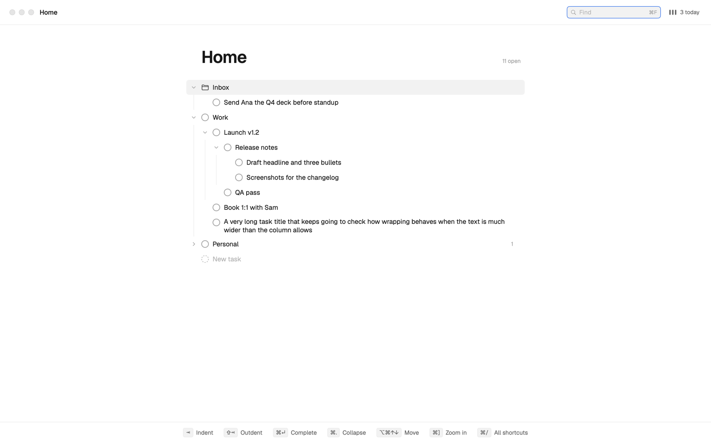

# Hush

A keyboard-first todo app that lives in the macOS menu bar and tries to stay out of your way.

Press **⌘⇧Space** from any app, type the task, press **↵**. You're back where you were. When you want to see everything, open the outline: nested tasks, WorkFlowy-style, driven entirely from the keyboard.




## Features
- **Quick Capture** (⌘⇧Space, rebindable): a floating field that never pulls other windows forward. ⇥ adds a note and a parent; `/name` files the task under a matching project.
- **Outline**: unlimited nesting, collapse, zoom into any branch, drag or ⌥⌘↑↓ to reorder, Find (⌘F), undo/redo for everything.
- **Completion that clears the list**: finished tasks strike through and fold away. They live in **History** (⌘Y), grouped by day, restorable.
- **Focus** (⌘⇧F): one task at a time, then the next.
- **Today** (⌘D): a short end-of-day summary and a quiet weekly view. No streaks, points, goals or notifications.
- **Local-first**: one SQLite file at `~/Library/Application Support/Hush/hush.sqlite`. No network, no account, no analytics.
- Light and dark, Reduce Motion, VoiceOver labels. Built on Vercel's [Geist](https://vercel.com/geist/introduction) design system.

## Install
Requires macOS 14 or later. There are no signed releases yet, so build it yourself (Xcode is not needed, the Command Line Tools are enough):

```sh
xcode-select --install          # if you don't have the Command Line Tools
git clone https://github.com/<you>/hush.git && cd hush
scripts/bundle.sh               # builds build/Hush.app (ad-hoc signed)
cp -R build/Hush.app /Applications/
open /Applications/Hush.app
```

Hush appears as a circle in the menu bar. Launch at login is in Settings (⌘,).

## Keyboard
| Where | Keys |
|---|---|
| Anywhere | ⌘⇧Space capture |
| Capture | ↵ save · ⌥↵ save and keep open · ⇥ details · esc dismiss |
| Outline | ↑↓ select · ↵ new task · ⇥ / ⇧⇥ indent / outdent · ⌘↵ complete · ⌘. collapse · ⌥⌘↑↓ move · ⌘] / ⌘[ zoom · ⌘⌫ delete · ⌘Z / ⇧⌘Z |
| Views | ⌘O outline · ⌘F find · ⌘Y history · ⌘D today · ⌘⇧F focus · ⌘/ all shortcuts · ⌘, settings |

## Development
```sh
swift build        # debug build
swift test         # HushCore test suite (Swift Testing)
scripts/bundle.sh  # release .app in build/
```
See [CONTRIBUTING.md](CONTRIBUTING.md), [docs/ARCHITECTURE.md](docs/ARCHITECTURE.md), [docs/CORE-API.md](docs/CORE-API.md) and [docs/DESIGN.md](docs/DESIGN.md).

## License
MIT, see [LICENSE](LICENSE). Geist Sans and Geist Mono are bundled under the SIL Open Font License 1.1 ([Resources/Fonts/OFL.txt](Resources/Fonts/OFL.txt)).
